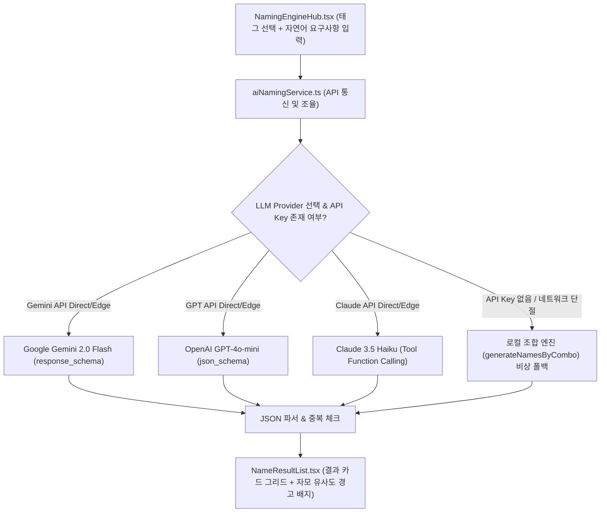

# [기획/명세서] AI 모델 API 연동 작명 파이프라인 상세 기획안

(AI Model API Integration Specification — Dual-Input Pipeline: Structured Taxonomy + Natural Language Narrative)

이 문서는 노벨플로우 작명 엔진(Naming Engine)이 **1) 계층형 태그 조합**과 **2) 자연어 서사 요구사항(Prompt)**을 결합하여, 실제 최적의 AI 모델 API(Gemini 2.0 Flash, GPT-4o-mini, Claude 3.5 Haiku)에 전달하고 강제 구조화 데이터(JSON Structured Outputs)로 응답받는 상용 서비스 수준의 연동 파이프라인 명세서입니다.

---

## 1. AI 모델 API 조사 결과 및 선정 가이드

| AI 모델명 | 요금 (1M 토큰 당) | Structured Outputs 지원 | 한국어/웹소설 네이밍 특성 | 추천 용도 |
| :--- | :--- | :--- | :--- | :--- |
| **Google Gemini 2.0 Flash** *(기본 추천)* | Input $0.10 / Output $0.40 | **100% 지원** (`response_schema`) | 압도적 생성 속도, 대량 아이디어 발상에 최적 | **기본 메인 작명 엔진 (속도/비용 최적)** |
| **OpenAI GPT-4o-mini** | Input $0.15 / Output $0.60 | **100% 지원** (`json_schema` strict) | 현대 웹소설/겜판/퓨전 트렌디한 네이밍 | **대중적 웹소설 감성 옵션** |
| **Anthropic Claude 3.5 Haiku** | Input $0.80 / Output $4.00 | **지원** (Function Calling 툴 강제) | 무협 한자 조어력, 고서정적 판타지 뉘앙스 최고 | **고급 무협/동양풍/고전 판타지 옵션** |

---

## 2. 2대 입력 축 (Dual-Input Protocol) 설계

AI 작명 요청 시 프롬프트 생성기에 전달되는 2가지 근원적 데이터:

```
[사용자 요청]
 ├── 1) 태그 조합 (Structured Taxonomy)
 │     ├── Target Category (character | location | equipment | skill | etc)
 │     ├── Subtype (예: 타격무기 - 워해머, 냉병기 - 단검, 산악, 무공/내공 등)
 │     ├── Genre, Culture, Trait/Mood, Phonetic Feel, Social Status
 │     └── 태그별 가중치 (weight 0.1~1.0)
 │
 └── 2) 자연어 서사 요구사항 (Natural Language Narrative Prompt)
       ├── 사용자가 자유롭게 입력한 캐릭터/아이템 서사 모티브 및 배경 설정
       │   (예: "어릴 적 용의 피를 마시고 불사의 육체를 얻었으나 밤마다 화염에 휩싸여 괴로워하는 비운의 용병")
       └── 제약 조건 (금지 음절, 필수 음절, 최소/최대 음절 길이)
```

---

## 3. 프롬프트 엔지니어링 & JSON Structured Output Schema

### 3-1. System Prompt
```text
당신은 최고의 웹소설/판타지/무협/SF 전문 AI 작명가입니다.
제공된 [카테고리], [세부유형], [태그 조합], 그리고 [사용자의 자연어 서사 요구사항]을 깊이 분석하여,
작품의 세계관에 완벽히 녹아드는 독창적이고 매력적인 이름을 생성해야 합니다.

[작명 지침]
1. 단순 기존 유명 작품 단어 복제 금지 (독창성 100% 보장).
2. 발음 어감 태그(경음, 격음, 유음, 폐쇄모음 등)의 정서적 인상을 이름의 음절 구조에 충실히 반영.
3. 사용자의 자연어 서사 요구사항(비하인드 스토리, 모티브)에서 상징적인 의미를 추출하여 어원(meaning)에 반영.
4. 반드시 지정된 JSON Schema 형식으로만 응답해야 합니다.
```

### 3-2. Response JSON Schema (Constrained Decoding)
```json
{
  "type": "ARRAY",
  "items": {
    "type": "OBJECT",
    "properties": {
      "name": { "type": "STRING", "description": "생성된 캐릭터/아이템/지명/기술 이름" },
      "meaning": { "type": "STRING", "description": "이름의 어원, 한자 풀이 또는 서사적 의미 상세 설명" },
      "tags": { "type": "ARRAY", "items": { "type": "STRING" }, "description": "해당 이름과 어울리는 어감/성격 태그" },
      "storySnippet": { "type": "STRING", "description": "해당 이름과 어울리는 1문장 서사 힌트" }
    },
    "required": ["name", "meaning", "tags"]
  }
}
```

---

## 4. 구현 아키텍처 및 파이프라인 구조



---

## 5. 단계별 개발 로드맵

1. **Step 1: AI 서비스 통신 모듈 작성 (`src/services/aiNamingService.ts`)**
   - Gemini 2.0 Flash / GPT-4o-mini REST API 및 Direct Client 통신 함수 작성.
   - 자연어 요구사항 + 태그 조합 -> JSON 프롬프트 변환기 구현.
   - API Key 미설정 시 로컬 엔진 폴백 연동.

2. **Step 2: Supabase Edge Function 확장 (`supabase/functions/generate-name/index.ts`)**
   - 서버 측에서 안전하게 Gemini/OpenAI API 호출 및 API Key 은닉 처리.

3. **Step 3: UI 확장 (`TagComboPanel.tsx` & `NamingEngineHub.tsx`)**
   - "자연어 서사 요구사항(Narrative Prompt)" 입력 전용 텍스트 영역 추가.
   - "AI 엔진 선택" 드롭다운 (Gemini 2.0 Flash [기본], GPT-4o-mini, Claude 3.5 Haiku, 로컬 조합).
   - 사용자 개인 API Key 설정 모달 / 입력 창 제공.

4. **Step 4: 검증 및 Self-Healing**
   - `npx tsc -b` & `npm run lint` 0 에러 유지.
   - 태그 + 자연어 서사 조합 AI 실제 생성 테스트.
