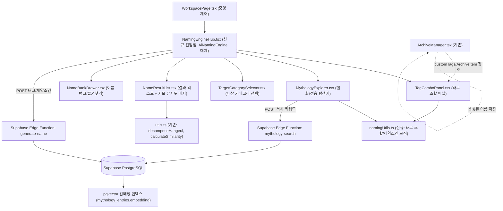

# 노벨플로우(Novelflow) 작명 엔진(Naming Engine) 고도화 상세 기획안

(Naming Engine Architecture, Database Schema, Component Design and Development Roadmap)

이 문서는 현재 목업(Mock) 상태로 구현된 AiNamingEngine.tsx와 JamoFilter.tsx를 실제 상용 서비스 수준의 통합 작명 엔진으로 재설계하기 위한 아키텍처, DB 스키마, 컴포넌트 설계, 개발 로드맵을 정의하는 명세서입니다. 커뮤니티 공유 기능은 이번 범위에서 제외합니다.

---

## 0. 현황 분석 및 목표

### 0-1. 현재 구현 상태 (As-Is)
* `src/components/workspace/AiNamingEngine.tsx`: fantasy/wuxia/modern/sf 4개 장르에 하드코딩된 이름 풀(pool)에서 무작위 선택하는 목업. 성별 토글, 키워드 입력 필드는 있으나 실제 로직에 반영되지 않음.
* `src/components/workspace/JamoFilter.tsx`: AiNamingEngine과 완전히 분리된 별도 탭으로, 초성/중성/종성 분해 후 Levenshtein 거리 기반 발음 유사도(75% 임계치)를 검사.
* `src/components/workspace/utils.ts`: `decomposeHangeul`, `getLevenshteinDistance`, `calculateSimilarity` 순수 함수 보유 — 재사용 대상.
* `src/components/workspace/types.ts`: `ArchiveItem { category: 'character'|'equipment'|'location'|'skill'|'etc', tags: string[], attributes: {key,value}[] }` 구조가 이미 존재 — "캐릭터 외 대상 생성" 요구사항과 정확히 맞아떨어침.
* `ArchiveManager.tsx`: 프로젝트별 커스텀 태그를 localStorage 키 `novelflow_custom_tags_{projectId}`로 관리하는 패턴이 이미 존재 — 태그 조합 엔진의 태그 소스로 그대로 연동 가능.

### 0-2. 목표 (To-Be)
기존 2개의 분리된 탭(AiNamingEngine, JamoFilter)을 하나의 작명 엔진(Naming Engine) 허브로 통합하고, 아래 3대 기능을 갖춘다.
1. **태그 조합 생성**: 계층형 태그를 자유롭게 조합해 빠르게 이름 생성.
2. **설화/전승 기반 추출**: 신화·민담 등 이야기 데이터베이스에서 사용자가 원하는 서사와 유사한 캐릭터/이름을 찾아 제공.
3. **다중 대상 생성**: 캐릭터뿐 아니라 ArchiveCategory 전체(장소, 장비/아이템, 기술/마법, 기타)로 생성 범위 확장.

---

## 1. 전체 아키텍처 개요



### 설계 원칙
* 기존 `JamoFilter.tsx`의 자모 유사도 로직은 별도 탭으로 존치하지 않고, `NameResultList.tsx` 내부에 실시간 통합한다 (결과가 나오는 즉시 기존 ArchiveItem 이름들과 자동 대조).
* `ArchiveManager.tsx`가 이미 갖춘 태그 관리 인프라(`customTags`, `allAvailableTags`)를 그대로 재사용하여 중복 개발을 피한다.
* 신규 대상 카테고리는 `ArchiveCategory` 타입을 그대로 사용하고 새로운 타입을 만들지 않는다.
* `system_architecture.md`의 `pgvector` 익스텐션을 그대로 활용한다.

---

## 2. 데이터베이스 스키마 (DDL 기획안)

```sql
-- 1. 계층형 작명 태그 마스터 테이블
CREATE TABLE IF NOT EXISTS public.naming_tags (
    id UUID PRIMARY KEY DEFAULT gen_random_uuid(),
    group_key VARCHAR(30) NOT NULL, -- 'genre' | 'culture' | 'trait' | 'phonetic' | 'social_status'
    label VARCHAR(50) NOT NULL, -- 예: '판타지 서양풍', '냉혹함', '단음절'
    parent_id UUID REFERENCES public.naming_tags(id) ON DELETE SET NULL, -- 상위 태그
    default_weight NUMERIC(3,2) DEFAULT 1.00,
    created_at TIMESTAMPTZ DEFAULT NOW()
);

-- 2. 사용자 저장 태그 조합 프리셋
CREATE TABLE IF NOT EXISTS public.naming_presets (
    id UUID PRIMARY KEY DEFAULT gen_random_uuid(),
    project_id UUID NOT NULL REFERENCES public.projects(id) ON DELETE CASCADE,
    name VARCHAR(100) NOT NULL, -- 예: "북부 야만족 남성 이름"
    target_category VARCHAR(20) NOT NULL, -- ArchiveCategory 값 재사용
    tag_weights JSONB NOT NULL, -- [{ "tag_id": "...", "weight": 0.8 }, ...]
    constraints JSONB, -- naming_constraints 참고
    created_at TIMESTAMPTZ DEFAULT NOW()
);

-- 3. 설화/전승/신화 코퍼스 (RAG 임베딩 검색 대상)
CREATE TABLE IF NOT EXISTS public.mythology_entries (
    id UUID PRIMARY KEY DEFAULT gen_random_uuid(),
    culture VARCHAR(50) NOT NULL, -- '그리스로마', '북유럽', '켈트', '한국전통', '동양', '아랍'
    story_title VARCHAR(150) NOT NULL, -- 예: "오디세이아", "단군신화"
    character_name VARCHAR(100) NOT NULL, -- 원어 인물/존재명
    romanization VARCHAR(100), -- 로마자 표기
    korean_reading VARCHAR(100), -- 한글 발음 표기
    meaning TEXT, -- 이름의 뜻/어원 설명
    story_summary TEXT NOT NULL, -- 서사 요약 (임베딩 대상 원문)
    fame_level VARCHAR(10) NOT NULL DEFAULT 'major', -- 'major' | 'minor'
    tags TEXT[] DEFAULT '{}', -- ['복수', '희생', '영웅의 여정', '트릭스터']
    source_url TEXT, -- 원전/공공 도메인 출처 링크
    embedding VECTOR(1536), -- story_summary 임베딩 (pgvector)
    created_at TIMESTAMPTZ DEFAULT NOW()
);

CREATE INDEX IF NOT EXISTS mythology_entries_embedding_idx
ON public.mythology_entries USING ivfflat (embedding vector_cosine_ops);

-- 4. 카테고리별 네이밍 템플릿 (인물/장소/아이템 등 문법 규칙)
CREATE TABLE IF NOT EXISTS public.naming_templates (
    id UUID PRIMARY KEY DEFAULT gen_random_uuid(),
    target_category VARCHAR(20) NOT NULL, -- ArchiveCategory 값
    template_key VARCHAR(50) NOT NULL, -- 예: 'location_suffix_style', 'item_modifier_style'
    pattern JSONB NOT NULL, -- { "prefixPool": [...], "bodyPool": [...] }
    description TEXT,
    created_at TIMESTAMPTZ DEFAULT NOW()
);

-- 5. 프로젝트별 작명 제약 조건
CREATE TABLE IF NOT EXISTS public.naming_constraints (
    id UUID PRIMARY KEY DEFAULT gen_random_uuid(),
    project_id UUID NOT NULL REFERENCES public.projects(id) ON DELETE CASCADE,
    forbidden_syllables TEXT[] DEFAULT '{}',
    required_syllables TEXT[] DEFAULT '{}',
    min_length INT DEFAULT 2,
    max_length INT DEFAULT 5,
    updated_at TIMESTAMPTZ DEFAULT NOW()
);

-- 6. 이름 뱅크 (즐겨찾기/보관/중복 방지)
CREATE TABLE IF NOT EXISTS public.name_bank (
    id UUID PRIMARY KEY DEFAULT gen_random_uuid(),
    project_id UUID NOT NULL REFERENCES public.projects(id) ON DELETE CASCADE,
    name TEXT NOT NULL,
    target_category VARCHAR(20) NOT NULL,
    meaning TEXT,
    origin_mythology_id UUID REFERENCES public.mythology_entries(id) ON DELETE SET NULL,
    status VARCHAR(10) NOT NULL DEFAULT 'saved', -- 'saved' | 'used' | 'discarded'
    linked_archive_item_id UUID, -- ArchiveItem.id와 연결
    created_at TIMESTAMPTZ DEFAULT NOW()
);

CREATE UNIQUE INDEX IF NOT EXISTS name_bank_unique_per_project
ON public.name_bank (project_id, name);
```

---

## 3. 기능별 상세 설계

### 3.1 태그 조합 생성 엔진 (`TagComboPanel.tsx`)
* **UI 구성**:
  * 계층형 태그 그룹 (`genre`, `culture`, `trait`, `phonetic`, `social_status`)
  * 각 태그 칩 클릭 시 `tag_weights` 상태에 `{ tagId, weight: 1.0 }` 추가, 칩 옆 소형 슬라이더로 0.1~1.0 가중치 조절.
  * "조합 저장" 버튼 → `naming_presets`에 저장, 상단 드롭다운에서 즐겨쓰는 프리셋 불러오기.
  * 기존 `ArchiveManager.tsx`의 `allAvailableTags`(프로젝트 커스텀 태그)를 `culture/trait` 그룹에 병합 노출하여 태그 체계 이원화 방지.
* **생성 로직 (`namingUtils.ts`)**:
  * 클라이언트 하드코딩 pool 및 Supabase Edge Function API / Local Engine 폴백 구조 제공.
  * 결과 수신 후 `calculateSimilarity` (기존 `utils.ts`)로 현재 프로젝트의 모든 `ArchiveItem.name`과 비교해 75% 이상이면 경고 배지 표시.

### 3.2 설화·전승 기반 캐릭터/이름 추출 엔진 (`MythologyExplorer.tsx`)
* **UI 흐름**:
  1. 문화권 선택 (`culture` 다중 선택 칩) + 유명도 슬라이더 (`fame_level`: 메이저 ↔ 마이너).
  2. 서사 키워드 자유 입력창: "복수를 위해 힘을 얻는 자", "죽음을 두려워하지 않는 트릭스터" 등.
  3. 검색 결과: 유사 서사 카드 목록 (원어명, 로마자 표기, 한글 발음, 뜻풀이, 원전 출처 링크 `source_url`, "파생 이름 생성" 버튼).
* **서사 유사도 매칭 및 파생 이름 생성**:
  * "원본 그대로 사용": `character_name`/`korean_reading`을 이름 뱅크에 저장.
  * "파생 이름 생성": 원전 이름을 `decomposeHangeul`로 분해 → 다른 후보 이름의 음절과 재조합 → `calculateSimilarity`로 원본과 40~70% 구간의 신규 이름 제시.

### 3.3 다중 대상 생성 확장 (`TargetCategorySelector.tsx`)
* `ArchiveCategory` (`character`/`equipment`/`location`/`skill`/`etc`) 선택 탭을 최상단에 배치하고, 선택된 카테고리에 따라 네이밍 문법 규칙을 동적으로 적용.
  * `character`: `{ surnamePool, givenNamePool }` — 문화권별 성+이름 조합
  * `location`: `{ prefixPool: ['검은','새벽','붉은'], suffixPool: ['성','숲','해','계곡','고원'] }`
  * `equipment`: `{ modifierPool: ['전설의','태초의','파멸의'], bodyPool: ['검','창','갑주'] }`
  * `skill`: 무협: 한자어 조합형({한자 뜻}+{한자 뜻}), 판타지: 룬어 조합형
  * `etc`: 조직/세력용 — `{ affix: ['기사단','상단','문파','클랜'] }`

### 3.4 부가 기능
* **일괄 생성(배치 모드)**: `NameResultList.tsx`에 "생성 개수" 입력 (기본 5, 최대 50) 추가.
* **이름 뱅크 & 즐겨찾기 & 중복 자동 제외 (`NameBankDrawer.tsx`)**:
  * 결과 카드의 "보관" 버튼 → `name_bank`에 저장.
  * 이미 쓴 이름 제외 목록 관리.
  * 캐릭터 확장 시 "아카이브에 등록" 버튼으로 `ArchiveItem` 신규 생성 및 연결.
* **제약 조건 필터 UI**: 금지 음절, 필수 음절, 음절 수(길이) 범위 슬라이더.
* **세계관 설정 자동 연동**: 현재 프로젝트의 ArchiveItem 태그 집계 후 culture/genre 태그 프리필.
* **한자 조합 모드 (무협/사극 전용)**: 원하는 뜻 선택 시 한자-훈음 2~3자 조합 생성 (`hanja_dict.json` 활용).
* **이름 변경 시 원고 일괄 치환 연동**: 이름 뱅크에서 최종 변경 시 `FindReplaceBar.tsx`/글로벌 치환 연동.

---

## 4. 컴포넌트 및 파일 구조

```
src/components/workspace/naming/
├── NamingEngineHub.tsx       (신규 진입점, WorkspacePage.tsx에서 기존 AiNamingEngine 대체)
├── TagComboPanel.tsx         (신규)
├── MythologyExplorer.tsx     (신규)
├── TargetCategorySelector.tsx (신규)
├── NameResultList.tsx        (신규: 기존 결과 카드 UI + 자모 유사도 배지 + 중복 경고)
├── NameBankDrawer.tsx        (신규: 이름 뱅크 및 보관함 서랍)
├── HanjaComboPanel.tsx       (신규: 한자 조합 서브 모드)
└── namingUtils.ts            (신규: 클라이언트 generator, Edge Function 통신, 설화 쿼리, 한자 사전 연동)
```

---

## 5. 개발 로드맵 (Phase)

* **Phase 1 — 기반 구조 및 태그 조합 리팩토링**
  * `naming_tags`, `naming_presets`, `naming_constraints`, `name_bank` 스키마/타입 정의.
  * `NamingEngineHub.tsx`, `TagComboPanel.tsx`, `NameResultList.tsx`, `TargetCategorySelector.tsx`, `namingUtils.ts` 구현.
  * `JamoFilter.tsx` 자모 분해/유사도 검증 로직을 `NameResultList.tsx`에 실시간 통합.
* **Phase 2 — 다중 대상 카테고리 확장 & 한자 조합 서브 모드**
  * 카테고리별 (`character`, `location`, `equipment`, `skill`, `etc`) 템플릿 알고리즘 및 UI 연동.
  * 한자 사전데이터 (`hanja_dict.json`) 및 한자 조합 서브 패널 (`HanjaComboPanel.tsx`) 구축.
* **Phase 3 — 설화/전승 코퍼스 및 매칭 엔진**
  * `MythologyExplorer.tsx` 및 시드 코퍼스 100~200개 구축 (`mythology_entries`).
  * 서사 키워드 벡터 매칭 및 파생 이름 생성 알고리즘 연동.
* **Phase 4 — 부가 기능 및 아카이브/원고 일괄 치환 연동**
  * `NameBankDrawer.tsx` 구현, 보관/사용/아카이브 등록 연동.
  * 일괄 생성 (배치 모드) 및 원고 치환 연동 모달 연동.
